<a href="https://rahul-mishra-myportfolio.vercel.app/">
  
</a>

  
  
  
  

  

 


  


  


<table>
<tr>
<td width="50%" align="center">
  <a href="https://github.com/RahulM1305/CodeChoreo"></a>
   
  
  
</td>
<td width="50%" align="center">
  <a href="https://github.com/RahulM1305/Get-Me-A-Coffee"></a>
   
  
  
</td>
</tr>
<tr>
<td width="50%" align="center">
  <a href="https://github.com/RahulM1305/Video-Chat-App"></a>
   
  
  
</td>
<td width="50%" align="center">
  <a href="https://github.com/RahulM1305/GatePass"></a>
   
  
</td>
</tr>
</table>

<b>📂 More projects</b>

 

| Project | What it is | Stack |
|---|---|---|
| [Password Manager](https://github.com/RahulM1305/Password-Manager-MongoDB) | Full-stack password manager | React · Tailwind · Express · MongoDB |
| [Fitness Website](https://github.com/RahulM1305/Fitness-website) · [live](https://fitness-website-mvjce.vercel.app/) | Workout guides, BMI calculator, calorie info | HTML · CSS · JS |
| [Todo List (React)](https://github.com/RahulM1305/Todo-List-Using-React) · [live](https://todo-list-using-react-tan.vercel.app/) | Todo app with localStorage persistence | React |
| [Friday Voice Assistant](https://github.com/RahulM1305/Friday-Voice-Assistant) | Voice-controlled desktop assistant | Python · SpeechRecognition |
| [Weather App](https://github.com/RahulM1305/Weather_App) | Real-time weather app | Flutter · Dart |
| [E-Commerce Interface](https://github.com/RahulM1305/E-Commerce-Interface) | Desktop electronics storefront | Python · Tkinter |

 


  

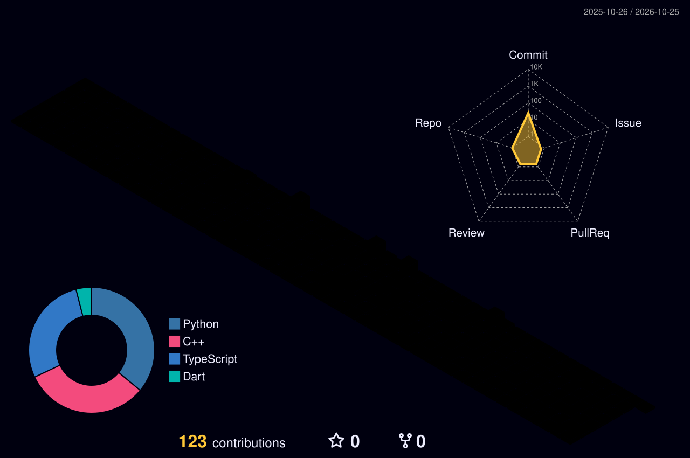

<picture>
  <source media="(prefers-color-scheme: dark)" srcset="https://raw.githubusercontent.com/RahulM1305/RahulM1305/output/github-snake-dark.svg" />
  <source media="(prefers-color-scheme: light)" srcset="https://raw.githubusercontent.com/RahulM1305/RahulM1305/output/github-snake.svg" />
  
</picture>

  

<a href="https://leetcode.com/u/RahulM1305/"></a>

  

